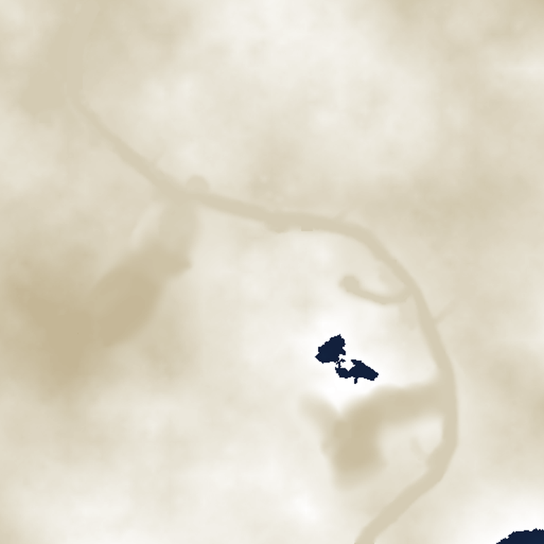
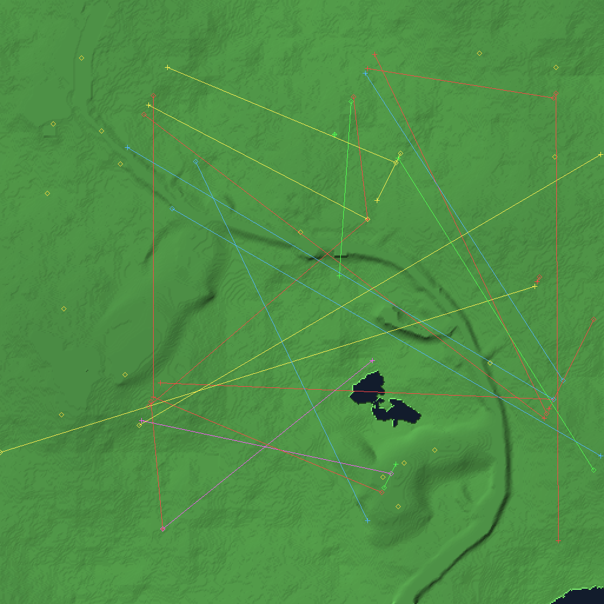

# Terra Nova resource reverse engineering

Reverse engineering of the resource formats used by **Terra Nova: Strike Force
Centauri** (Looking Glass Technologies, 1996).

Terra Nova uses the same `LG Res File v2` container as System Shock 1. That
container is documented by the System Shock community. Everything Terra Nova
puts *inside* it is not.

This repository is a specification and reference implementation for those
payloads: a C library, a CLI, a software scene renderer, and a Python reference
implementation used to cross-check the C decoder.



*Heightfield decoded from `MAP50A.RES` chunk `0x56` (513×513 vertices).*



*Composite scene: decoded terrain, 17 mission waypoints and 27 entity routes.
Software rasteriser, ~150 fps at 513×513; see `docs/SCENE.md`.*

## Status

| Layer | State |
|---|---|
| `LG Res File v2` container (header, TOC) | parsed, 18/18 demo files |
| Subchunk directories | parsed, 6,644 subchunks |
| 14-bit LZ decompressor | implemented (unused in demo data) |
| Chunk type classification | 13 types; 6 Terra Nova extensions identified |
| Terrain heightfield | decoded and verified (`docs/MAP.md`) |
| Bitmap frames (raw + RLE) | 1,194 / 1,194 frames, 0 errors (`docs/BITMAP.md`) |
| Entity records | 27 records; team + two coordinates verified (`docs/ENTITIES.md`) |
| Mission data | waypoints, 47 operations, simulation tables (`docs/MISSION.md`, `docs/CAMPAIGN.md`) |
| Scene compositor | terrain + entities + waypoints (`docs/SCENE.md`) |
| Palette | open — not stored in the resource files |

## Build

```powershell
.\scripts\build.ps1 -Toolchain C:\path\to\mingw64\bin
```

or, with `gcc` already on `PATH`:

```sh
make
```

## Use

```sh
python scripts/fetch_demo.py                      # 18 .RES files, 5.4 MB
./lgres info   data/demo/TN1/DATA/MAP50A.RES
./lgres list   data/demo/TN1/DATA/MAP50A.RES
./lgres cat    data/demo/TN1/DATA/MAP50A.RES 0x56 -o terrain.bin
./lgres bmpscan data/demo/TN1/DATA/*.RES
./lgres scene  data/demo/TN1/DATA/MAP50A.RES data/demo/TN1/DATA/MISS1D.RES -o scene.ppm
./lgres bench  data/demo/TN1/DATA/MAP50A.RES 500 1

python tools/probe_map.py  data/demo/TN1/DATA/MAP50A.RES
python tools/entities.py   data/demo/TN1/DATA/MAP50A.RES
python tools/waypoints.py  data/demo/TN1/DATA/MISS1D.RES
python tests/conformance.py                       # C vs Python, 1,252 chunks
python tests/frames.py                            # 1,194 frames, 0 errors
```

## Findings

- The demo contains **1,252 top-level chunks** across 18 files, in 13 content
  types. Six types (`0x06, 0x08, 0x0C, 0x0D, 0x10, 0x12`) are Terra Nova
  extensions over the documented System Shock set. See `docs/FORMAT.md`.
- `0x06` is a shade / palette-remap table (4,096 or 2,048 bytes).
- `0x07` is Creative VOC audio, 378 chunks in `DEMOSND.RES`.
- `0x02` is a sprite bank: one subchunk per frame, 28-byte header, codecs
  2/5 (raw) and 4 (RLE). **1,194 frames, 0 errors, 7.97 M pixels.** The RLE
  long opcode is a fill, not a literal copy.
- In `MAP50A.RES`, `0x56` is **3 × 513²** terrain vertices and `0x55` is the
  257² LOD. Only the third byte is height: its mean adjacent delta is 0.49,
  against 43–77 for the other two bytes. See `docs/MAP.md`.
- Waypoint positions are stored as **16.16 fixed point**; 17 are named in the
  demo. See `docs/MISSION.md`.

## Data

No game data is stored in this repository. Fetch the freely distributed demo:

```sh
python scripts/fetch_demo.py
```

## Legal

See `NOTICE.md`. No game data or game assets are included. The images under
`docs/img/` are schematic visualisations of decoded numeric data (heightfield,
coordinates), not reproductions of game artwork.
