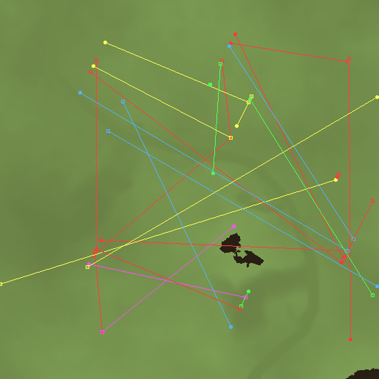

# Entity records

`MAP50A.RES` contains a block of fixed-size tables in chunks `0x78`–`0x8F`.
Each non-empty chunk is a subchunk container of **50-byte records**:

| Chunk | Records |
|---|---|
| `0x78` | 8 |
| `0x79` | 5 |
| `0x7A` | 5 |
| `0x7B` | 5 |
| `0x7C` | 4 |
| `0x7D`–`0x8F` | 0 (empty containers) |

27 records total. Only bytes `+0x00`–`+0x19` are ever non-zero; the remaining 24
bytes are reserved.

## Layout

```
+0x00  u8    always 0
+0x01  u8    team / owner, 0..4
+0x02  u16   unknown A
+0x04  u16   unknown B
+0x06  u16   always 0
+0x08  u24   18-bit coordinate: x = v & 0x1FF, y = (v >> 9) & 0x1FF
+0x0B  u8    always 0
+0x0C  u24   18-bit coordinate, same encoding
+0x0F  u32   reserved
+0x13  u16   always 0
+0x18  u16   unknown C
+0x1A  ..    reserved to 0x32
```

## Verified

- **Record size 50**, 26 meaningful bytes. Every table is a plain subchunk
  container.
- **Team** at `+1` takes five values, `0..4`. `0x7A`, `0x7B` and `0x7C` each
  contain one record per team, in a different order. `0x78` is eight records all
  with team 0, so it is a different category.
- **Coordinates**: both 24-bit values decode as 9.9 packed x/y. Every one of the
  54 endpoints falls inside 0..511, matching the 513×513 terrain in chunk
  `0x56`. The high byte of each 24-bit value is only ever 0–3, exactly what a
  9-bit y coordinate produces.
- Coordinates are **shared between records**: `(312,186)` appears as a source in
  two records and a destination in a third; `(130,337)`, `(470,339)`,
  `(138,449)` are each shared too. So these are not independent random offsets.



*Source (dot) and destination (square) endpoints over the decoded heightfield,
coloured by team. Lines are drawn only to show pairing.*

## Open

The three unknown fields appear in stable combinations:

| `?A` | `?B` | `?C` | records |
|---|---|---|---|
| 0 | 0 | 0 | 8 |
| 40192 | 0 | 0 | 7 |
| 30 | 64 | 20480 | 5 |

That looks like a small number of entity/order types rather than per-record data.
The remaining records have unique combinations.

Not yet established:

- whether `?A`/`?B` are a type id, a packed parameter pair, or something else;
- which of the two coordinates is "spawn" and which is "target" (the names
  `from`/`to` in the tooling are placeholders);
- whether the five tables are unit classes, order types, or mission phases.

The way to settle these is to correlate the coordinates against actual mission
objects, which needs either the mission file (`DEMOMIS1.RES`, `MISS1D.RES`) or a
runtime trace. That is the next step.

## Tooling

```sh
python tools/entities.py data/demo/TN1/DATA/MAP50A.RES
python tools/entities.py data/demo/TN1/DATA/MAP50A.RES --plot out.png
```
