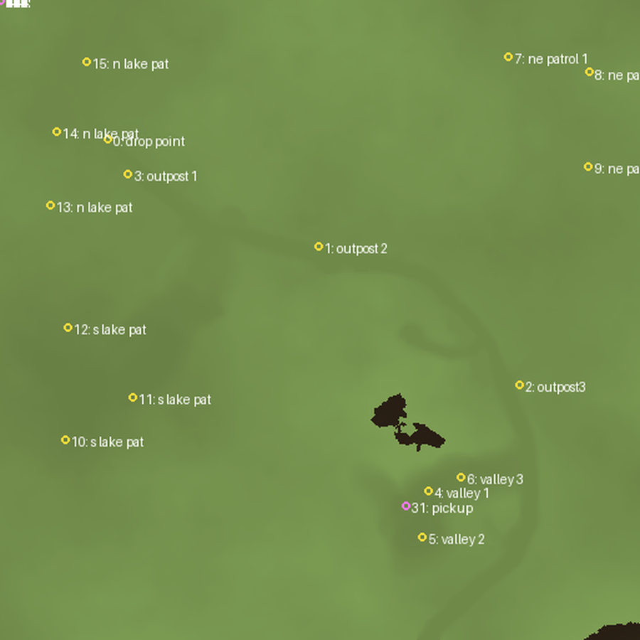

# Mission data (`MISS1D.RES`, `DEMOMIS1.RES`)

`MISS1D.RES` is the mission definition. It is a flat set of chunks, no
subchunk containers except `0x00AD` and `0x00AF`.

## Inventory

| Chunk | Size | Contents |
|---|---|---|
| `0x00AA` | 80 | mission → map filename: `MAP50A.RES` |
| `0x00AB` | 512 | 128 × 16-byte tileset names: `Default`, `Set 1`..`Set 5` |
| `0x00AC` | 512 | 128 × 16-byte group names: `(NULL GRP)`, `base 1`, … |
| `0x00AD` | 4,218 | 78 subchunks, repeated `ddddddd` padding |
| `0x00AE` | 32 | 32 × `0x02` |
| `0x00AF` | 537 | 9 subchunks, objective text |
| `0x00B0` | 1,024 | **128 × 8-byte waypoint positions** |
| `0x00B1` | 2,048 | **128 × 16-byte waypoint names** |
| `0x00B2` | 59 | `sky0.res` |
| `0x00B5` | 1,604 | all zero in the demo |
| `0x00B6` | 1,280 | 320 × 4-byte values, small integers |

## Waypoints

`0x00B1` is 128 fixed 16-byte names. `0x00B0` is the matching 128 × 8-byte
position table. Each position is **two 16.16 fixed-point values**, x then y:

```
+0x00  u32  x, 16.16 fixed point
+0x04  u32  y, 16.16 fixed point
```

This is the first confirmed use of 16.16 fixed point in the engine. It also
confirms the coordinate space: every value is in 0..512, matching the 513×513
terrain grid in `MAP50A.RES` chunk `0x56`.

Seventeen entries are populated in the demo:

| # | Name | x | y |
|---|---|---|---|
| 0 | drop point | 86.000 | 111.500 |
| 1 | outpost 2 | 255.250 | 197.000 |
| 2 | outpost3 | 416.375 | 308.375 |
| 3 | outpost 1 | 102.625 | 139.500 |
| 4 | valley 1 | 343.000 | 393.500 |
| 5 | valley 2 | 338.500 | 430.000 |
| 6 | valley 3 | 369.500 | 382.500 |
| 7 | ne patrol 1 | 407.500 | 45.000 |
| 8 | ne patrol 2 | 472.000 | 57.750 |
| 9 | ne patrol 3 | 471.500 | 133.000 |
| 10 | s lake pat1 | 52.000 | 352.000 |
| 11 | s lake pat2 | 106.000 | 318.000 |
| 12 | s lake pat3 | 54.000 | 262.000 |
| 13 | n lake pat1 | 40.000 | 164.000 |
| 14 | n lake pat2 | 45.000 | 105.000 |
| 15 | n lake pat3 | 69.000 | 49.000 |
| 31 | pickup | 325.125 | 405.125 |



*Waypoints over the decoded heightfield. The outposts, valleys and patrol
routes line up with the terrain; `pickup` sits inside the valley.*

## Objective text

`0x00AF` contains nine strings, describing the mission objectives in the same
order as the outposts:

```
- Outpost 1
- Outpost 2
TERRORISM ZONE
- OUTPOST 2
- PIRATE BARRACKS
- Outpost 3
PROBABLE COMMAND
TION
POST LOCATION
- PICKUP POINT
```

## Relationship to the entity tables

The entity records in `MAP50A.RES` (`docs/ENTITIES.md`) use the same 0..512
space, but their endpoints do **not** coincide with these waypoints: the median
distance from an entity endpoint to its nearest waypoint is 63 units, and only
three of 54 are within 12. So they are independent spawn or order positions, not
references to the named waypoint table.

The waypoint table is still useful as ground truth: it independently confirms
the coordinate scale, the axis order, and the 16.16 encoding.

## Open

- `0x00B6` (320 × 4-byte small integers) is unread.
- `0x00AD`'s 78 subchunks have not been parsed.
- `DEMOMIS1.RES` (29 chunks, 8 KB) has not been decoded; `0x06AA` holds mission
  names (`OPERATION MADISON`, `OPERATION BRICKDRAGGER`, …).
