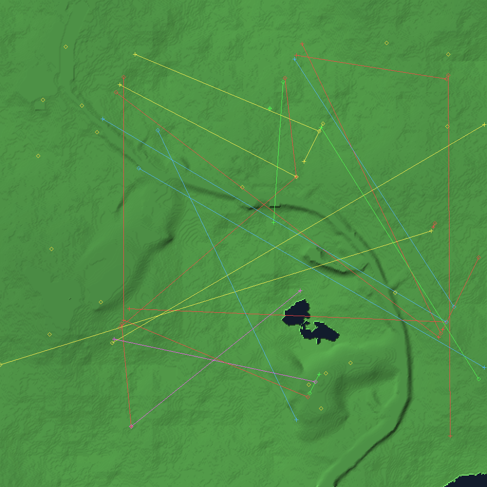

# Scene compositor

`lgres scene` composites the decoded data into one image:

- terrain from `MAP50A.RES` chunk `0x56` (513×513 heightfield), shaded by slope
- entity records from chunks `0x78`–`0x7C`: source (cross), target (circle) and
  a line between them, coloured by team
- waypoints from `MISS1D.RES` chunk `0x00B0`, drawn as diamonds



*1026×1026 render: terrain, 17 waypoints, 27 entity routes.*

## Frame rate

`lgres bench` renders the terrain and entity overlay repeatedly and reports
wall-clock throughput. Measured on the development machine, GCC 16.2 `-O2`:

| Output | Pixels | Frames | Time | Rate |
|---|---|---|---|---|
| 513×513 | 263,169 | 500 | 3.34 s | **149.8 fps** |
| 1026×1026 | 1,052,676 | 200 | 4.81 s | **41.5 fps** |

The 513×513 case is used as the comparison point for the game's 640×480 mode
(307,200 pixels); it is about 15% fewer pixels, so the real 640×480 rate is
slightly below 150 fps but comfortably above 60.

This is a **software** rasteriser: per-pixel height ramp, slope shading, Bresenham
lines, and marker blits. No GPU, no SDL, no external dependency.

## Sprite playback

`tools/anim.py` decodes every frame of a bitmap bank and writes a sprite sheet
and an animated GIF. Example: the crater/explosion bank `0x048C` (8 frames,
10×9 to 64×64).

Frames are still index data, so they are rendered as grey until the palette is
recovered (see `docs/BITMAP.md`).

## Reproduce

```sh
./lgres scene data/demo/TN1/DATA/MAP50A.RES data/demo/TN1/DATA/MISS1D.RES -o scene.ppm
./lgres bench data/demo/TN1/DATA/MAP50A.RES 500 1
./lgres bench data/demo/TN1/DATA/MAP50A.RES 200 2
python tools/anim.py data/demo/TN1/DATA/RESDMOBJ.RES 0x048C sheet.png anim.gif
```
